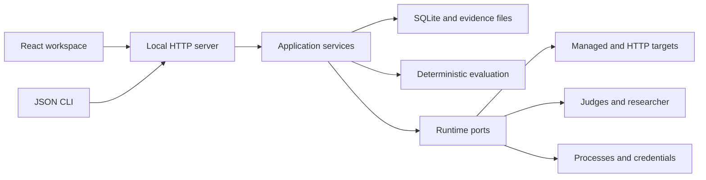

# Architecture

Agent Evaluation Harness is a local workstation application with one headless engine.
React and the JSON CLI share command contracts, saved Runs, and grading rules.
Managed agents and external HTTP targets use the same execution lifecycle.

Read the [build charter](build-charter.md) for requirements and [acceptance criteria](acceptance.md) for intended guarantees.
This page describes the current working-tree design.
The [architecture audit](architecture-audit.md) records its baseline, coverage, defects, and validation limits.

## Components and dependencies

**startServer** composes the runtime and application unless tests inject an application.
**createApplication** opens the workspace, constructs services, recovers interrupted work, and dispatches validated commands.
Shutdown drains admitted commands and closes owned resources.
The CLI is an HTTP client and never opens the database.

| Component and relationship                                      | Source evidence                                                                                                                                                                                                                                         |
| --------------------------------------------------------------- | ------------------------------------------------------------------------------------------------------------------------------------------------------------------------------------------------------------------------------------------------------- |
| React and CLI submit shared operations through HTTP             | [web API](../src/web/api.ts), [runCli](../src/cli.ts), [startServer](../src/server.ts), [command schemas](../src/contracts.ts).                                                                                                                         |
| HTTP delegates product rules to application services            | [createApplication and dispatch](../src/application/application.ts).                                                                                                                                                                                    |
| Application owns persistence and evaluation                     | [RunService](../src/application/runs.ts), [CatalogService](../src/application/catalog.ts), [EvaluationService](../src/application/evaluations.ts), [Database](../src/storage/database.ts), [scoring](../src/evaluation/scoring.ts).                     |
| Application uses runtime ports supplied by concrete composition | [RuntimePort](../src/contracts.ts), [runtime composition](../src/runtime/index.ts), [target registry](../src/runtime/targets/registry.ts).                                                                                                              |
| Runtime owns providers, processes, and credentials              | [harness](../src/runtime/harness.ts), [LocalRuntime.judge](../src/runtime/index.ts), [ProcessSupervisor](../src/runtime/process-supervisor.ts), [ConnectionService](../src/runtime/connections.ts), [platform composition](../src/runtime/platform.ts). |

The [architecture checker](../scripts/architecture-check.mjs) enforces production import direction.
Contracts depend on their own declarations and Zod.
Domain rules depend on contracts.
Storage and evaluation cannot import runtime or web modules.
Application services use storage, pure rules, and runtime ports.
Runtime cannot import application services.
React owns presentation and draft state without Node APIs.
Only composition selects concrete platform services.
The checker separates credential infrastructure from process ownership and rejects retired-repository imports.

## State and ownership

| Concept                      | Ownership and lifetime                                                                                        |
| ---------------------------- | ------------------------------------------------------------------------------------------------------------- |
| Bank and evaluator revision  | Catalog publishes immutable question/reference and grading snapshots.                                         |
| Blueprint                    | Reusable launch settings; changed settings create a new saved configuration.                                  |
| Run                          | Frozen target, questions, evaluator, repetitions, and limits, with mutable lifecycle and display preferences. |
| Result and attempt           | A logical question/repetition slot and its physical invocations.                                              |
| Retry application            | Immutable binding of sealed retry answers to original logical slots.                                          |
| Assessment pass              | Named frozen judgments and provenance; selection is a separate Run preference.                                |
| Research session             | One exact provider conversation and ordinary baseline/candidate Runs.                                         |
| Target invocation checkpoint | Private resource recovery state, separate from immutable answer evidence.                                     |

There is no Study, Experiment, or Campaign execution hierarchy.
[Contracts](../src/contracts.ts) define operations and records.

## Storage and schema ownership

[Database](../src/storage/database.ts) owns schema version 7, transactions, immutable-record constraints, indexed queries, and ordered events.
Migrations preserve recorded evidence and fail transactionally; a newer unknown schema is rejected.
The migration sequence lives in **Database.initialize**, with rollback and preservation cases in [database tests](../src/storage/database.test.ts).

An exclusive SQLite transaction in a separate [ownership file](../src/storage/owner-lock.ts) prevents two engines from owning one workspace.
The lock releases after process death and contains no product records.
This is local ownership rather than distributed scheduling.

Completed evidence uses a staging file, atomic rename, and persisted hash.
Evaluators verify sealed evidence before consuming it.
Unreferenced staging files are not grading input.
[AnswerSources](../src/application/answer-sources.ts) resolves logical selections to physical attempt identifiers and hashes.
Retry applications create bindings and derived assessments without editing physical attempts.

## Operation traces

### Navigate the workspace

The [App](../src/web/app.tsx) selects Question banks, Runs, or Settings from the browser hash.
Runs uses `#/runs` for the library, `#/runs/new` for setup, and `#/runs/<id>` for live or saved details.
The existing `#/results`, `#/run`, and `#/observe/<id>` routes remain aliases with their query selections intact.
Setup identity uses the workspace, source Run, and blueprint rather than the route spelling or query order.
Navigation and reload read saved state without launching work.
The [Runs library](../src/web/runs.tsx) owns comparison, blueprints, configuration reuse, and export entry points.
[Observe](../src/web/observe.tsx) remains the shared live and saved Run view.

### Publish a question bank

The [bank workspace](../src/web/bank-workspace.tsx) owns a draft with captured revision identifiers.
The [catalog](../src/application/catalog.ts) prepares questions and public answer formats, validates references, and runs [calibration](../src/application/calibration.ts).
It checks source revisions before calibration and again before atomically publishing question and evaluator revisions.
Invalid formats, failed calibration, or competing changes reject publication without a partial revision.
[Bank findings](../src/application/bank-findings.ts) use the same path and commit decisions with the revisions.
Earlier Runs keep their frozen references and evaluator.
See [question-bank design](question-bank-design.md) for draft/import/finding failures and [evaluator design](evaluator-design.md) for policies and current applicability limits.

### Launch, observe, and control

[Setup](../src/web/setup.tsx) persists the complete parsed request and idempotency key before submission.
The tab-local draft is scoped by durable workspace identity.
An uncertain response preserves the exact request across navigation or reload; acknowledgment clears it.
Explicit reset permits a separate request.
Storage failure and unavailable dependencies remain visible.

[RunService.launch](../src/application/runs.ts) validates selection and compatibility, freezes the manifest, and records launch identity.
[TargetInvocations](../src/application/target-invocations.ts) and the registry admit work.
Events are persisted before observation.
Only completed sealed answers enter grading.
Malformed submissions receive structural feedback before sealing; execution failures remain distinct from incorrect judgments.

Pause stops admissions and lets active attempts settle.
Halt interrupts work and leaves unfinished slots resumable.
Cancel becomes terminal after cleanup settles.
Resume never repeats completed slots.
Startup reconciles abandoned attempts and recovers missing deterministic assessments without rerunning targets.
Unknown external completion requires duplicate-work acknowledgment before potentially repeating a request.
Unconfirmed cleanup blocks unsafe admission.

[Observe](../src/web/observe.tsx) reads summaries and merges cursor-based events.
The engine owns control eligibility.
See [configuration guidance](configuration-guide.md) for user recovery and [runtime](runtime.md) for cleanup limits.

### Retry, assess, review, and compare

[RunRetries](../src/application/run-retries.ts) creates an ordinary linked Run for eligible failed slots with frozen configuration.
[RetryApplicationService](../src/application/retry-applications.ts) validates compatibility and sealed sources before atomically binding answers.
Replays return the recorded application; conflicts fail.
Original attempts remain historical evidence.

[EvaluationService](../src/application/evaluations.ts) grades saved answers without invoking targets.
[AssessmentPassService](../src/application/assessment-passes.ts) creates deterministic, LLM, Jev, and attributed human passes.
[Judge evidence](../src/application/judge-evidence.ts) verifies physical sources and assembles sealed evidence.
Judge requests are checkpointed before admission; interrupted requests are explicit rather than automatically replayed.
Human review derives a pass while retaining untouched judgments.
[Legacy review migration](../src/application/legacy-reviews.ts) records unresolved provenance as unjudged.

Summary and detail share assessment verdict and coverage rules.
Accuracy counts completed correctness judgments; execution, abstention, exclusions, and missing judgments remain separate.
Comparison checks compatibility of selected assessment bases.
[ComparisonService](../src/application/comparisons.ts) assembles logical outcome counts, selected historical assessment metrics, and compatibility through one path.
Physical failures remain available in attempt details even after an answer is recovered.
See [judging](judging.md) for independent providers, evidence, recovery, and spending.

### Research and spending

[ResearchService](../src/application/research.ts) completes a baseline before requesting candidates from one persistent conversation.
The initial bundle contains objectives, configuration, instructions, budgets, and identifiers without golds or transcripts.
Evidence retrieval is explicit; gold retrieval is audited.
Mutation validation constrains candidates, which use the ordinary Run engine.
A fixed eligible basis and coverage guard prevent failures from improving selection by shrinking the denominator.

Pending inputs and conversation identifiers are checkpointed.
Unavailable continuity or exhausted context stops the session instead of replacing the conversation.
Launch replay shares initialization and reconciles a committed baseline receipt.
Evidence resolves authorized original and adopted physical attempts and drains each scoped event cursor.
Responses above 16 MiB fail explicitly without returning partial evidence; whole-Run requests can select a result instead.

[Research budgets](../src/application/research-budget.ts) count target, researcher, and judge usage separately.
Unknown usage blocks admissions under a configured spending ceiling.
Thresholds cannot retract work already in flight.
[Performance](../src/application/performance.ts) and [usage projection](../src/application/usage-projection.ts) preserve subtotals, unknown components, and pending counts.
Conversation increments and physical judgment identifiers prevent double counting.
Historical cache recovery is bounded to 4,096 events and 1 MiB per attempt with a 1,000-entry settled-attempt cache.
Missing or inconsistent components remain unknown.

## Configuration, trust, and external boundaries

[Configuration guidance](configuration-guide.md) owns precedence, setup, drafts, and operation.
[Runtime](runtime.md) owns process and secret lifetimes.
[Target adapters](target-adapters.md) owns registration; [HTTP targets](http-targets.md) owns the external protocol.

The server accepts loopback binding and validates Host and Origin.
This is not user authentication against other local processes.
Configured provider and external requests leave the machine.
Saved traces can contain sensitive question, answer, and tool data.

Expected values, reference rows, and custom evaluator code stay inside the engine.
Public answer shapes and selected comparison requirements are deliberately disclosed through [evaluation guidance](../src/contracts/evaluation-guidance.ts).
Runs freeze configuration rather than live datasource contents.
[Configuration export](../src/application/runs.ts) substitutes credential placeholders and excludes bank references and expected answers.

Secrets live in a separate machine-local DPAPI or Keychain store.
Copied workspaces require entering credentials again.
Managed bindings freeze an opaque credential version with its provider and endpoint identity.
Historical invocation resolves that version strictly, while explicit reuse can bind locally entered credentials for a compatible identity in a new manifest.
Legacy snapshots remain readable but require explicit compatible rebinding before invocation.
Process containment is platform-specific and is not a general sandbox.
Windows Job Objects and macOS process groups have different guarantees.
Native Mac acceptance and actual provider behavior remain separate from fixture tests.

## Queries and scalability

**Database.runPage** filters bank, status, and normalized Unicode search before pagination and counts the same matching set.
Summary projections remove transcripts, evaluator code, and detailed grading bodies before deserialization.
Attempt and research-turn detail are explicit reads.
Retry queries use indexed parent Runs and physical source metadata.
Event consumers must drain scoped cursor pages when complete history is required.
These mechanisms bound ordinary observation payloads without establishing large-workspace latency guarantees.

## Build, tooling, and change placement

[package.json](../package.json) requires Node.js 22.13.0 or newer; [.nvmrc](../.nvmrc) selects Node.js 24.
**npm ci** installs the lockfile.
**npm run build** emits server/CLI artifacts to **dist** and Vite assets to **web-dist**.
**npm start** serves those artifacts, so source edits require a new build.
The timestamp build identifier distinguishes builds without certifying correspondence to dirty source.
Development uses separate API and Vite processes; the default proxy targets API port 4381.

The package is private.
No installer or release-publication workflow is present.
There is no active hosted CI workflow.
The [pre-push hook](../.githooks/pre-push) calls the [local CI runner](../scripts/local-ci.ts), which owns installation and push validation.
Install it with **npm run hooks:install** after **npm ci** in each checkout.
The installer preserves conflicting effective **core.hooksPath** settings, including inherited settings.
When that setting is absent, non-sample files in Git's resolved default hooks directory also prevent installation.

For outgoing updates, the runner requires every non-deletion commit, including peeled annotated tags, to equal the initial HEAD.
It rejects tracked, staged, untracked, and submodule changes before running **npm run validate** one time with closed standard input.
It forwards validation output and failure status, then rechecks HEAD and checkout cleanliness before reporting the validated commit.
Deletion-only pushes need no validation.
Push unrelated branches or tags separately from their own checked-out commits.

Keep the checkout idle throughout validation and push.
These checks detect persistent changes; they do not provide a filesystem snapshot or detect changes reverted between checks.
Ignored dependencies and generated output are outside the cleanliness check.
The gate runs on your machine without GitHub Actions minutes or hosted runners.
Local hooks require installation and can be bypassed by Git, so they are not server-enforced branch protection.
Passing locally establishes results only for that machine's operating system and Node.js version.
Native Mac acceptance and other platform checks require separate recorded results.
Generated builds, dependencies, workspaces, and databases are ignored and are not architecture sources.

| Change                  | Primary owner and verification                                             |
| ----------------------- | -------------------------------------------------------------------------- |
| Public operation/record | Contracts, application dispatch, HTTP/CLI acceptance fixtures.             |
| Run rules/recovery      | RunService, domain lifecycle, application and invocation tests.            |
| Grading/publication     | Evaluation, catalog/calibration, policy and publication fixtures.          |
| Judging/review          | Shared evidence, LLM/Jev services, passes and failure fixtures.            |
| Provider/adapter        | Runtime composition/registry, adapter, process, secret, and HTTP fixtures. |
| Presentation/drafts     | Web modules, shared commands, component tests and browser acceptance.      |
| Schema/queries          | Database migrations/projections, rollback and consistency tests.           |
| Ancillary scripts       | Scripts, explicit type checks, isolated workflow execution.                |

**npm run validate** runs formatting, import boundaries, types, lint, tests, and build.
The architecture checker has its own [regression tests](../tests/architecture-check.test.ts).
The offline [preview seeder](../scripts/seed-observation-preview.ts) imports fixture runtime support and participates in TypeScript checking.
Pass `--data-directory` to verify it in an isolated workspace.
No repository-local plugin or skill package was found.
[AGENTS.md](../AGENTS.md) owns contributor instructions.
Historical records retain their actual checks; the [audit ledger](architecture-audit.md) owns this review's evidence and limits.
